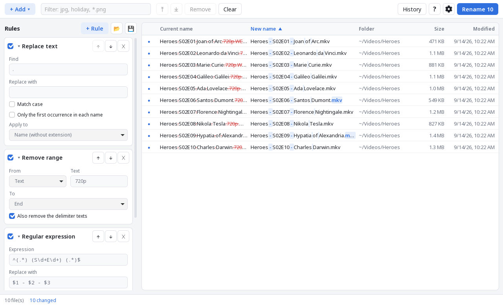
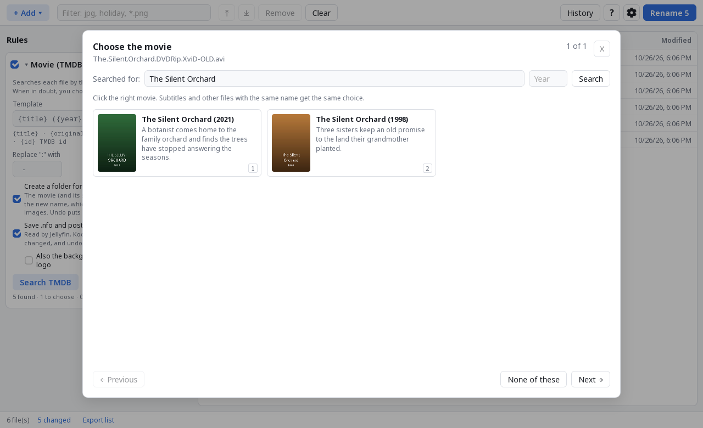
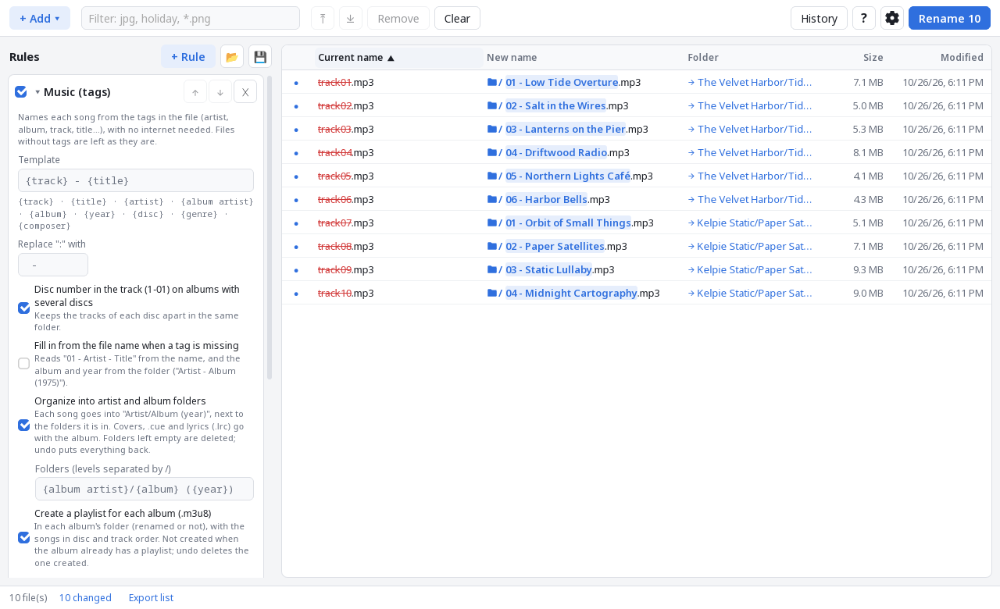
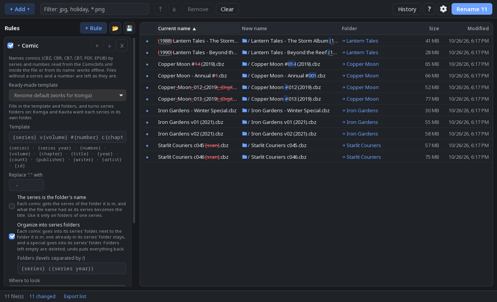
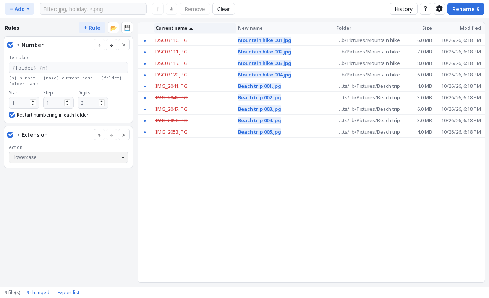
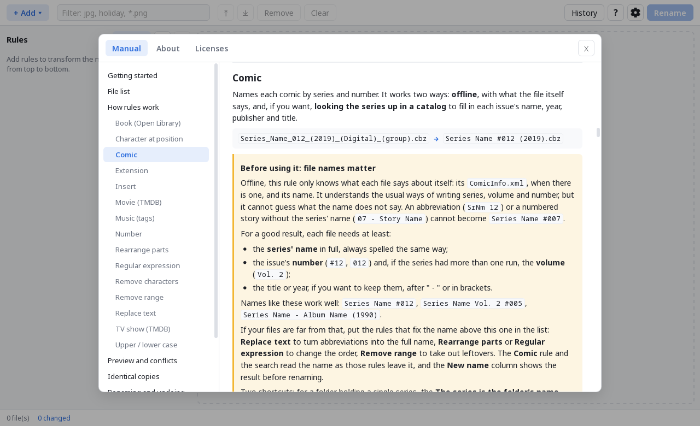
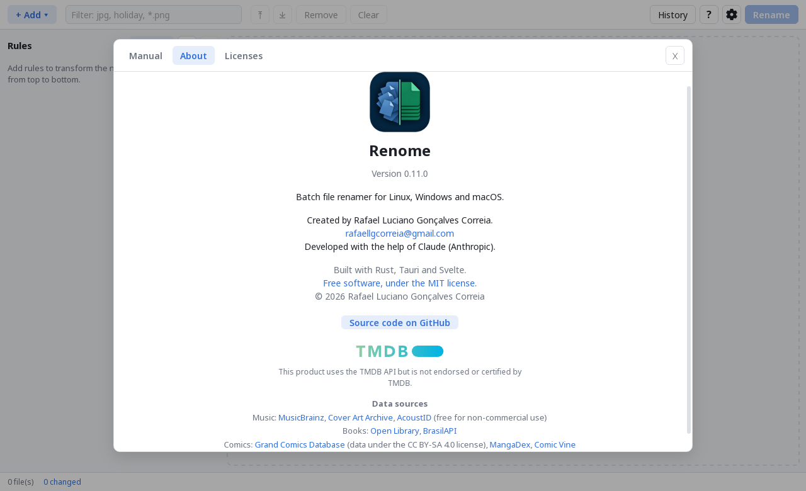

<p align="center">
  
</p>

<h1 align="center">Renome</h1>

<p align="center">
  Rename hundreds of files at once, see every new name before anything
  changes, and undo it all if you change your mind.<br>
  Free and open source, for Linux, Windows and macOS.
</p>

<p align="center">
  <a href="https://github.com/rafaellgc/Renome/releases/latest"><b>Download</b></a> ·
  <a href="#features">Features</a> ·
  <a href="#screenshots">Screenshots</a>
</p>



## How it works

1. **Add your files**: drag files or folders into the window.
2. **Stack a few rules**: replace text, number, insert the date a photo was
   taken, rearrange parts of the name… Each rule works on the result of the
   one above it.
3. **Check the preview**: the new names update as you type, with what changes
   highlighted. Problems such as two files ending up with the same name are
   flagged before anything happens.
4. **Rename**: nothing is ever overwritten, and every rename can be undone
   from the History, even after closing the app.

A built-in manual (F1) explains every rule with examples.

## Features

- Rules: replace text, regular expression, rearrange parts
  (`Show - Title - S01E01` → `Show - S01E01 - Title`), upper/lower case,
  insert text, date (including the date a photo was taken, from EXIF) or
  folder name, numbering (optionally restarting in each folder), remove
  characters, remove range, character at position, extension.
- Renames folders too, even together with the files inside them.
- The preview highlights what is removed and added in each name.
- Finds files with identical content in the list (even with different
  names) and shows them grouped, without deleting anything.
- Movies: names files from TMDB (`Title (Year) [tmdbid-12345]`, the format
  Jellyfin recognizes), picking the movie automatically when sure and
  letting you choose when not; optionally saves `.nfo` and poster next
  to each movie for Jellyfin, Kodi and Emby.
- TV shows: names episodes from TMDB (`Show (Year) - S01E02 - Title`),
  reading the number in many forms (`S01E02`, `1x02`, `T1 E2`,
  `Season 1 Episode 2`, absolute numbering) and checking it against the
  title in the name; when they disagree, you choose. A folder mixing
  several shows is looked up show by show. Optionally organizes
  them into `Show (Year) [tmdbid-…]/Season 01` and saves `tvshow.nfo`,
  episode `.nfo` files and images for Jellyfin, Kodi and Emby. Aired
  episodes missing from the seasons you have show up as faded rows, and
  can be exported to a CSV file.
- Music: names songs from their tags (`01 - Title`, artist, album, year,
  disc…; the artist too on compilations), optionally organizing them
  into `Artist/Album (Year)` folders, with covers, lyrics and bonus
  tracks going along. Optionally identifies each album
  on MusicBrainz (by track count and lengths, choosing the edition when
  unsure) to fix titles and names, and saves the album's cover. Songs
  without tags, and albums the search cannot find, are identified by
  their sound (AcoustID). Can also write a `.m3u8` playlist for each
  album, and the release's tags and cover into the songs themselves
  (undoable).
- Books: names EPUB, MOBI, AZW3, PDF, FB2 and DjVu files from Open Library
  (`Author - Title (Year)`), using the ISBN, title and author stored in
  the file or its name; ISBNs Open Library does not know are looked up on
  BrasilAPI (Brazilian editions). Picks the book automatically when sure
  and lets you choose when not; optionally organizes them into
  `Author/Title` folders and saves `cover.jpg` and a `metadata.opf`
  (read by Audiobookshelf and e-book managers). The book files are never
  changed.
- Comics: names CBZ, CBR, CB7, CBT, PDF and EPUB files by series and
  number (`Series #012 (2019)`, `Series v03` for manga volumes), from the
  `ComicInfo.xml` inside the file or from its name (issue numbers,
  volumes, tomes, chapters, years; release notes ignored), offline.
  Optionally looks the series up on the Grand Comics Database (editions
  from many countries; a free account, signed in for the session only),
  MangaDex (manga, no account) or Comic Vine (your own key), and organizes
  series folders (with ready-made templates for Komga and Kavita).
- Movie, TV show, book and comic lookups read the name as the rules above
  them leave it, so a "Replace text" can fix an abbreviation first.
- Edit any new name by hand right in the preview (double-click or F2).
- List filter: only the visible files are renamed.
- Sort by new name (default) or by any column.
- Conflicts are caught before renaming (duplicate names, existing files,
  invalid names, characters Windows does not accept).
- Safe two-phase renaming: swaps (a↔b) work and files are never overwritten.
  If the program or the computer stops halfway through a rename or an
  undo, the next start puts every file back under a real name.
- Persistent history with **undo**, even after closing the app.
- Export the list (current name, new name, folder, status) to CSV, to
  check a big batch in a spreadsheet.
- Rule presets saved as JSON.
- Works from the keyboard: Ctrl+Enter renames, Ctrl+Z undoes the last
  change to the list, arrows move through the list, F2 edits a name, F1
  opens the manual.
- Interface in English, Portuguese and Spanish; light, dark or system theme.

## Screenshots

| | |
|---|---|
|  |  |
| Movies: when two have the same title, you choose | Music: named and sorted into `Artist/Album (Year)` from the tags |
|  |  |
| Comics: series, number and series folders, offline (dark theme) | Photos numbered per folder, with the folder name |
|  |  |
| Built-in manual, in English, Portuguese and Spanish | About, with the data sources |

All names in the screenshots are made up.

The functional specification is in [SPEC.md](SPEC.md).

## Download

Installers are attached to each [release](https://github.com/rafaellgc/Renome/releases):

| System | Files |
|---|---|
| Linux | `.AppImage` (any distro), `.flatpak`, `.deb`, `.rpm` |
| Windows | `-setup.exe` or `.msi` |
| macOS | `.dmg` (Intel and Apple Silicon) |

The installers are not signed, so Windows (SmartScreen) and macOS
(Gatekeeper) will show a warning the first time. On macOS, right-click the
app and choose *Open*.

The Flatpak is not on Flathub but has its own repository, so updates arrive
through `flatpak update` or the software center:

```
flatpak install --user https://rafaellgc.github.io/Renome/io.github.rafaellgc.Renome.flatpakref
```

The downloaded `.flatpak` file (double click, or `flatpak install --user
Renome_<version>_x86_64.flatpak`) also takes updates from that repository.
The GNOME runtime it needs comes from Flathub.

## Layout

```
crates/renome-core/   pure Rust core (rules, preview, apply, history) + tests
src-tauri/            Tauri app: commands that expose the core to the UI
src/                  SvelteKit UI (SPA)
```

## Development

The core builds and tests anywhere:

```sh
cargo test -p renome-core
```

The app needs Node 22 and the
[Tauri prerequisites](https://v2.tauri.app/start/prerequisites/) for your system.

```sh
npm install
npm run tauri dev      # development mode
npm run tauri build    # installers in target/release/bundle/
```

On immutable distros (Fedora Silverblue, Bazzite…), build inside a distrobox:

```sh
distrobox create --name renome-dev --image registry.fedoraproject.org/fedora-toolbox:44
distrobox enter renome-dev -- sudo dnf install -y webkit2gtk4.1-devel openssl-devel \
  libappindicator-gtk3-devel librsvg2-devel libxdo-devel gcc gcc-c++ nodejs npm rpm-build
distrobox enter renome-dev
```

## Command line

```sh
renome ~/Pictures/trip file1.txt file2.txt
```

The given paths go into the initial list.

## Builds and releases

`.github/workflows/build.yml` builds for all three systems on GitHub:

- on every push to `main`, the installers are under *Actions → run → Artifacts*;
- pushing a tag (`git tag v0.2.0 && git push --tags`) creates a draft
  *Release* with all of them attached, and a Flatpak bundle built from
  `flatpak/io.github.rafaellgc.Renome.yml` (also made when the workflow is
  run by hand). The tag also refreshes the signed Flatpak repository on the
  `gh-pages` branch (`flatpak/publish-repo.sh`), signed with the GPG key in
  the `FLATPAK_GPG_KEY` secret.

## Credits

Created by Rafael Luciano Gonçalves Correia, developed with the help of
Claude (Anthropic).

Renome is and will stay free. If it helps you and you would like to give
something back, you can [leave a tip on Ko-fi](https://ko-fi.com/rafaellgc).

## License

[MIT](LICENSE). The licenses of the open source components built into the
app are listed in its Licenses tab (Help → Licenses), generated when
building.
