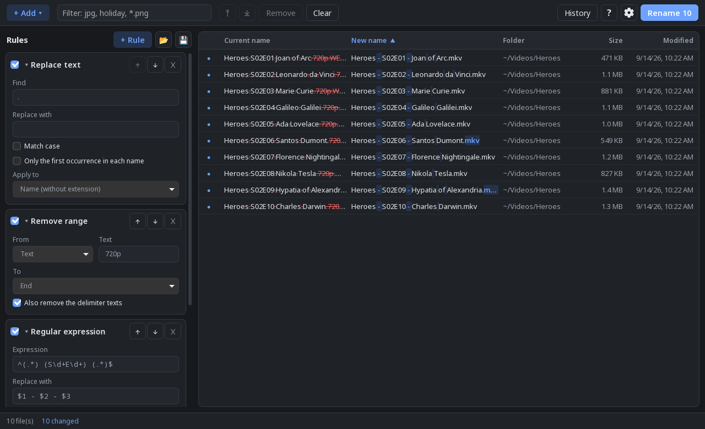

<p align="center">
  
</p>

<h1 align="center">Renome</h1>

<p align="center">
  Rename hundreds of files at once, see every new name before anything
  changes, and undo it all if you change your mind.<br>
  Free and open source, for Linux, Windows and macOS.
</p>

<p align="center">
  <a href="https://github.com/rafaellgc/Renome/releases/latest"><b>Download</b></a> ·
  <a href="#features">Features</a> ·
  <a href="#screenshots">Screenshots</a>
</p>


## How it works

1. **Add your files**: drag files or folders into the window.
2. **Stack a few rules**: replace text, number, insert the date a photo was
   taken, rearrange parts of the name… Each rule works on the result of the
   one above it.
3. **Check the preview**: the new names update as you type, with what changes
   highlighted. Problems such as two files ending up with the same name are
   flagged before anything happens.
4. **Rename**: nothing is ever overwritten, and every rename can be undone
   from the History, even after closing the app.

A built-in manual (F1) explains every rule with examples.

## Features

- Rules: replace text, regular expression, rearrange parts
  (`Show - Title - S01E01` → `Show - S01E01 - Title`), upper/lower case,
  insert text, date (including the date a photo was taken, from EXIF) or
  folder name, numbering (optionally restarting in each folder), remove
  characters, remove range, character at position, extension.
- Renames folders too, even together with the files inside them.
- The preview highlights what is removed and added in each name.
- Finds files with identical content in the list (even with different
  names) and shows them grouped, without deleting anything.
- Movies: names files from TMDB (`Title (Year) [tmdbid-120]`, the format
  Jellyfin recognizes), picking the movie automatically when sure and
  letting you choose when not; optionally saves `.nfo` and poster next
  to each movie for Jellyfin, Kodi and Emby.
- TV shows: names episodes from TMDB (`Show (Year) - S01E02 - Title`),
  reading the number in many forms (`S01E02`, `1x02`, `T1 E2`,
  `Season 1 Episode 2`, absolute numbering) and checking it against the
  title in the name; when they disagree, you choose. Optionally organizes
  them into `Show (Year) [tmdbid-…]/Season 01` and saves `tvshow.nfo`,
  episode `.nfo` files and images for Jellyfin, Kodi and Emby.
- Edit any new name by hand right in the preview (double-click or F2).
- List filter: only the visible files are renamed.
- Sort by new name (default) or by any column.
- Conflicts are caught before renaming (duplicate names, existing files,
  invalid names, characters Windows does not accept).
- Safe two-phase renaming: swaps (a↔b) work and files are never overwritten.
- Persistent history with **undo**, even after closing the app.
- Rule presets saved as JSON.
- Keyboard shortcuts: Ctrl+Enter renames, Ctrl+Z undoes the last change to
  the list, F1 opens the manual.
- Interface in English, Portuguese and Spanish; light, dark or system theme.

## Screenshots

| | |
|---|---|
|  |  |
| Photos from two folders, numbered per folder with the folder name | Dark theme |
|  |  |
| Built-in manual, in English, Portuguese and Spanish | About |

The functional specification is in [SPEC.md](SPEC.md).

## Download

Installers are attached to each [release](https://github.com/rafaellgc/Renome/releases):

| System | Files |
|---|---|
| Linux | `.AppImage` (any distro), `.deb`, `.rpm` |
| Windows | `-setup.exe` or `.msi` |
| macOS | `.dmg` (Intel and Apple Silicon) |

The installers are not signed, so Windows (SmartScreen) and macOS
(Gatekeeper) will show a warning the first time. On macOS, right-click the
app and choose *Open*.

## Layout

```
crates/renome-core/   pure Rust core (rules, preview, apply, history) + tests
src-tauri/            Tauri app: commands that expose the core to the UI
src/                  SvelteKit UI (SPA)
```

## Development

The core builds and tests anywhere:

```sh
cargo test -p renome-core
```

The app needs Node 22 and the
[Tauri prerequisites](https://v2.tauri.app/start/prerequisites/) for your system.

```sh
npm install
npm run tauri dev      # development mode
npm run tauri build    # installers in target/release/bundle/
```

On immutable distros (Fedora Silverblue, Bazzite…), build inside a distrobox:

```sh
distrobox create --name renome-dev --image registry.fedoraproject.org/fedora-toolbox:44
distrobox enter renome-dev -- sudo dnf install -y webkit2gtk4.1-devel openssl-devel \
  libappindicator-gtk3-devel librsvg2-devel libxdo-devel gcc gcc-c++ nodejs npm rpm-build
distrobox enter renome-dev
```

## Command line

```sh
renome ~/Pictures/trip file1.txt file2.txt
```

The given paths go into the initial list.

## Builds and releases

`.github/workflows/build.yml` builds for all three systems on GitHub:

- on every push to `main`, the installers are under *Actions → run → Artifacts*;
- pushing a tag (`git tag v0.2.0 && git push --tags`) creates a draft
  *Release* with all of them attached.

## Credits

Created by Rafael Luciano Gonçalves Correia, developed with the help of
Claude (Anthropic).

## License

[MIT](LICENSE)
